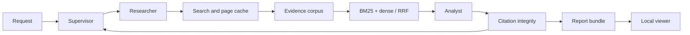
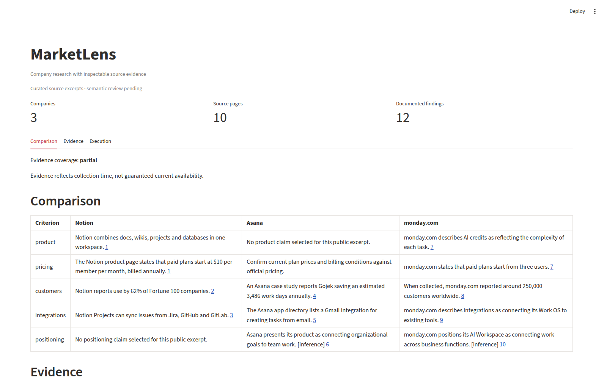

# MarketLens

Evidence-linked company research for product and competitive analysis. Enter 2–3 company websites; obtain an English comparison covering product, pricing, customers, integrations and positioning. Inspect the retained excerpt behind each cited claim.

**Status:** local lint, types, package build, and 23 unit/integration tests pass. Two real Kaggle GPU smoke runs completed. A small retrieval diagnostic is measured below; human report review remains a release requirement.

## Quick start

```bash
uv sync --frozen --extra dev --extra validation --extra viewer --extra collection
source .venv/bin/activate
marketlens research examples/request.json --demo --output outputs/demo
marketlens evaluate outputs/demo/corpus.jsonl examples/synthetic-questions.jsonl
marketlens view outputs/demo
```

The demo uses explicitly synthetic content, not company facts. The viewer can inspect saved real research without a GPU or API key.

## Live research

Install `.[research]` on a CUDA machine or follow notebooks/kaggle_research.ipynb. Set TAVILY_API_KEY in the environment, in `.env` in the working directory, or in Kaggle Secrets. Existing environment variables take precedence over `.env`; the local file is excluded from Git. Run `marketlens research examples/request.json --output outputs/live` from the product directory. Reuse the same output directory and identical settings to resume cached evidence and progress; use a new directory for a new request. Internet access is needed for models and collection. Default limits are 30 search calls, 30 documents and two follow-up rounds.

## Kaggle without API keys

```bash
# From the product directory, with TAVILY_API_KEY in the ignored .env:
marketlens collect examples/request.json --output outputs/live-collection
# Run the following on a CUDA machine with the research extra installed:
marketlens research examples/request.json --sources outputs/live-collection/sources.json --output outputs/live
```

The collector uses at most 30 Basic search attempts and balances the document budget across companies. Snapshots contain source text and URLs, not credentials. Snapshot research only reuses collected pages; follow-up queries cannot discover new pages. Citation timestamps preserve snapshot collection time.

For Kaggle, build the wheel, run `python scripts/prepare_kaggle.py`, and upload the staged allowlist as a **private** Dataset. `notebooks/kaggle_snapshot.ipynb` consumes that dataset; `notebooks/kernel-metadata.json` defines the private GPU run. Run `kaggle kernels push -p notebooks --accelerator NvidiaTeslaT4 -t 3600`. The current account-specific metadata can be changed for another account. Dataset contents and generated reports remain private until reviewed.

## Architecture



Reports include claims, source excerpts, collection timestamps and limitations. SQLite retains cache/checkpoint state; FAISS stores the live dense index. Website text is treated as untrusted data. Citation checks validate identifiers and exact quotes; semantic support is evaluated separately.

## Claim assessment

Research now filters vendor-domain URLs, excluding community/recruiting pages and mission-template pages used for company positioning. URL eligibility does not establish authorship or truth. Each candidate passes quote integrity and a bounded contextual model assessment before retention; partial or uncertain findings remain unknown. Candidate and assessment traces are retained privately.

To reassess a fixed report on CUDA without generating replacements, use `marketlens audit REPORT.json --output outputs/audit`, or the private notebook in `notebooks/audit/`. The assessor uses the same model family as the generator and is not an independent human judge.

The frozen coding-agent review of v2 found 10 supported-in-context records, 7 partial, 4 requiring better sources, 1 incorrect attribution, and 8 unknown. These are regression-case judgments, not human accuracy measurements. The original report has **22 retained records and 8 unknown**; earlier narrative counts of 21/9 were incorrect. `report_summary` now derives counts directly from the artifact.

A fixed-input GPU audit completed in 195.3 seconds on T4, without regenerating claims or using search credits. It retained 13 records and left 17 unknown. Against the frozen agent judgments, it withheld 8/12 flagged records but also lost 1/10 supported records. Of the retained records, 9/13 matched the agent-supported label, versus 10/22 before; coverage fell from 12/15 to 9/15 cells. Four flagged records remain. This is a regression diagnostic on observed cases, **not human precision or evidence of production readiness**. Exact decisions remain available with the private report; summary and input hashes are in docs/experiments/fixed-report-audit.json.

## Public demo

[Read the curated report](examples/reports/saas-sample.md) · [Download the 2-minute walkthrough](docs/demo/walkthrough.mp4) · [English captions](docs/demo/walkthrough.srt)



Run `marketlens view examples/reports/saas-sample.json` to inspect the public example. It contains agent-selected and narrowed claims from the live source corpus, with at most 25 quoted words per source page. It is **not the raw LLM report or a human-expert-reviewed analysis**. The silent walkthrough holds four actual viewer states for 30 seconds each; it is not a continuous screen recording. Full corpora, checkpoints and the 30-record review sheet remain private/local.

## Measured results

A real-source smoke run completed on Tesla T4: 29 claim records across 15 comparison cells, 129 evidence chunks, and 623.6 seconds of pipeline time. Three records were converted to unknown after citation checks. The revised run produced 30 records (22 retained, 8 unknown) across 12/15 covered cells in 659.1 seconds on T4, using 200 chunks. Both demonstrate execution, not semantic accuracy.

On a separate 202-chunk frozen corpus, the following diagnostic used **20 agent-curated test questions**, each with one known supporting chunk:

| Retrieval | Labeled-chunk Recall@5 | MRR@5 |
|---|---:|---:|
| BM25 | 0.75 | 0.554 |
| Dense | 0.90 | 0.662 |
| Hybrid / RRF | 0.95 | 0.717 |

These are small diagnostic results, not an independently judged benchmark. The 10 development queries concern Notion; the 20 test queries concern Asana and monday.com. Equivalent supporting chunks may be unlabeled. Five unanswerable controls are excluded from retrieval averages. Source authorship, claim meaning, pricing context and freshness still require review. See docs/evaluation.md and docs/experiments/ for exact hashes, runtime versions and limitations.

## Validation and portfolio

Run `python -m unittest discover -s tests -v`. CI also checks lint, types, package build and commit messages. See docs/development.md for GitHub workflow and docs/evaluation.md for benchmark protocol. Codex reads AGENTS.md; ask it to implement the PRP in PRPs/company-research.md and execute its validation commands.

Include measured live results, screenshots and a two-minute demo in the first release. CV bullets should describe implemented work and link to the repository; add numeric achievements only after measurement.
