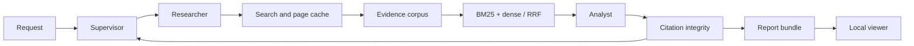

# MarketLens

Evidence-linked company research for product and competitive analysis. Enter 2–3 company websites; obtain an English comparison covering product, pricing, customers, integrations and positioning. Inspect the retained excerpt behind each cited claim.

**Status:** local lint, types, package build, and 12 unit/integration tests pass. A private Kaggle GPU smoke run is in progress. Real-source benchmark and human claim review remain acceptance steps.

## Quick start

```bash
uv sync --frozen --extra dev --extra validation --extra viewer
source .venv/bin/activate
marketlens research examples/request.json --demo --output outputs/demo
marketlens evaluate outputs/demo/corpus.jsonl examples/synthetic-questions.jsonl
marketlens view outputs/demo
```

The demo uses explicitly synthetic content, not company facts. The viewer can inspect saved real research without a GPU or API key.

## Live research

Install `.[research]` on a CUDA machine or follow notebooks/kaggle_research.ipynb. Set TAVILY_API_KEY in the environment, in `.env` in the working directory, or in Kaggle Secrets. Existing environment variables take precedence over `.env`; the local file is excluded from Git. Run `marketlens research examples/request.json --output outputs/live` from the product directory. Reuse the same output directory and identical settings to resume cached evidence and progress; use a new directory for a new request. Internet access is needed for models and collection. Default limits are 30 search calls, 30 documents and two follow-up rounds.

## Kaggle without API keys

```bash
# From the product directory, with TAVILY_API_KEY in the ignored .env:
marketlens collect examples/request.json --output outputs/live-collection
# Run the following on a CUDA machine with the research extra installed:
marketlens research examples/request.json --sources outputs/live-collection/sources.json --output outputs/live
```

The collector uses at most 30 Basic search attempts and balances the document budget across companies. Snapshots contain source text and URLs, not credentials. Snapshot research only reuses collected pages; follow-up queries cannot discover new pages. Citation timestamps preserve snapshot collection time.

For Kaggle, build the wheel, run `python scripts/prepare_kaggle.py`, and upload the staged allowlist as a **private** Dataset. `notebooks/kaggle_snapshot.ipynb` consumes that dataset; `notebooks/kernel-metadata.json` defines the private GPU run. Run `kaggle kernels push -p notebooks --accelerator NvidiaTeslaT4 -t 3600`. The current account-specific metadata can be changed for another account. Dataset contents and generated reports remain private until reviewed.

## Architecture



Reports include claims, source excerpts, collection timestamps and limitations. SQLite retains cache/checkpoint state; FAISS stores the live dense index. Website text is treated as untrusted data. Citation checks validate identifiers and exact quotes; semantic support is evaluated separately.

## Validation and portfolio

Run `python -m unittest discover -s tests -v`. CI also checks lint, types, package build and commit messages. See docs/development.md for GitHub workflow and docs/evaluation.md for benchmark protocol. Codex reads AGENTS.md; ask it to implement the PRP in PRPs/company-research.md and execute its validation commands.

Include measured live results, screenshots and a two-minute demo in the first release. CV bullets should describe implemented work and link to the repository; add numeric achievements only after measurement.
