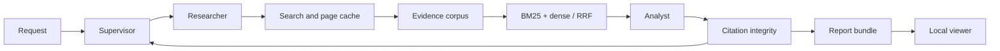

# MarketLens

Evidence-linked company research for product and competitive analysis. Enter 2–3 company websites; obtain an English comparison covering product, pricing, customers, integrations and positioning. Inspect the retained excerpt behind each cited claim.

**Status:** initial implementation; synthetic offline checks are available. Live Kaggle inference, real-source benchmark and human claim review remain acceptance steps.

## Quick start

```bash
uv venv
uv pip install -e '.[dev,viewer]'
marketlens research examples/request.json --demo --output outputs/demo
marketlens evaluate outputs/demo/corpus.jsonl examples/synthetic-questions.jsonl
marketlens view outputs/demo
```

The demo uses explicitly synthetic content, not company facts. The viewer can inspect saved real research without a GPU or API key.

## Live research

Install `.[research]` on a CUDA machine or follow notebooks/kaggle_research.ipynb. Set TAVILY_API_KEY in the environment or Kaggle Secrets. Run `marketlens research examples/request.json --output outputs/live`. Reuse the same output directory and identical settings to resume cached evidence and progress; use a new directory for a new request. Internet access is needed for models and collection. Default limits are 30 search calls, 30 documents and two follow-up rounds.

## Architecture



Reports include claims, source excerpts, collection timestamps and limitations. SQLite retains cache/checkpoint state; FAISS stores the live dense index. Website text is treated as untrusted data. Citation checks validate identifiers and exact quotes; semantic support is evaluated separately.

## Validation and portfolio

Run `python -m unittest discover -s tests -v`. CI also checks lint, types, package build and commit messages. See docs/development.md for GitHub workflow and docs/evaluation.md for benchmark protocol. Codex reads AGENTS.md; ask it to implement the PRP in PRPs/company-research.md and execute its validation commands.

Include measured live results, screenshots and a two-minute demo in the first release. CV bullets should describe implemented work and link to the repository; add numeric achievements only after measurement.
